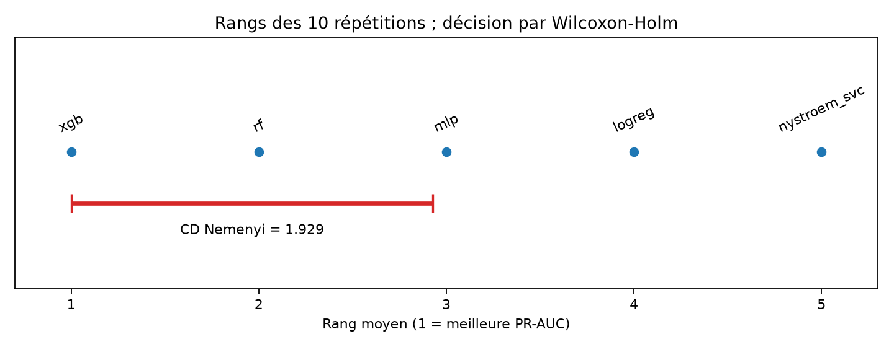

# Validation statistique P2

PR-AUC confirmatoire ; métriques secondaires exploratoires.
Unité : 10 moyennes de répétition par modèle ; les 50 plis ne sont jamais traités comme indépendants.

Friedman : χ²=40, p=4.32842e-08, W de Kendall=1.

| Modèle | PR-AUC moyenne | IC bootstrap 95 % | Brier moyen |
|---|---:|---:|---:|
| logreg | 0.369704 | [0.369183, 0.370323] | 0.004224 |
| rf | 0.867540 | [0.866320, 0.868717] | 0.001570 |
| xgb | 0.893470 | [0.891662, 0.895252] | 0.001344 |
| nystroem_svc | 0.359026 | [0.355968, 0.361978] | 0.003779 |
| mlp | 0.691750 | [0.676029, 0.706462] | 0.002240 |

## Métriques secondaires — exploratoires

Moyennes des 10 répétitions, sans test d'hypothèse ni sélection après coup.

| Métrique | logreg | rf | xgb | nystroem_svc | mlp |
|---|---:|---:|---:|---:|---:|
| roc_auc | 0.911247 | 0.995396 | 0.997476 | 0.915890 | 0.993765 |
| mcc | 0.463019 | 0.819153 | 0.834264 | 0.416972 | 0.701039 |
| precision | 0.501989 | 0.870541 | 0.889027 | 0.382078 | 0.686913 |
| recall | 0.452263 | 0.773265 | 0.785257 | 0.469894 | 0.724761 |
| f1 | 0.454264 | 0.818068 | 0.832905 | 0.414391 | 0.699284 |
| accuracy | 0.994650 | 0.998312 | 0.998454 | 0.993509 | 0.996927 |
| brier_score | 0.004224 | 0.001570 | 0.001344 | 0.003779 | 0.002240 |
| log_loss | 0.020166 | 0.006559 | 0.005596 | 0.018089 | 0.009250 |
| ece | 0.001480 | 0.000889 | 0.000822 | 0.000759 | 0.000855 |

| Paire | Différence moyenne | IC 95 % | r rang-bisérial | p brute | p Holm |
|---|---:|---:|---:|---:|---:|
| logreg − rf | -0.497836 | [-0.498912, -0.496750] | -1.000 | 0.00195312 | 0.0195312 |
| logreg − xgb | -0.523766 | [-0.525818, -0.521758] | -1.000 | 0.00195312 | 0.0195312 |
| logreg − nystroem_svc | 0.010677 | [0.007850, 0.013576] | 1.000 | 0.00195312 | 0.0195312 |
| logreg − mlp | -0.322046 | [-0.336351, -0.306629] | -1.000 | 0.00195312 | 0.0195312 |
| rf − xgb | -0.025930 | [-0.028122, -0.023695] | -1.000 | 0.00195312 | 0.0195312 |
| rf − nystroem_svc | 0.508514 | [0.504834, 0.512009] | 1.000 | 0.00195312 | 0.0195312 |
| rf − mlp | 0.175790 | [0.161606, 0.191158] | 1.000 | 0.00195312 | 0.0195312 |
| xgb − nystroem_svc | 0.534443 | [0.530934, 0.538046] | 1.000 | 0.00195312 | 0.0195312 |
| xgb − mlp | 0.201720 | [0.188117, 0.217295] | 1.000 | 0.00195312 | 0.0195312 |
| nystroem_svc − mlp | -0.332723 | [-0.347272, -0.316283] | -1.000 | 0.00195312 | 0.0195312 |

Seuil d'effet non négligeable : 0.010000 point de PR-AUC. Décision **post hoc**, prise après observation du benchmark ; cette réanalyse n'est pas une confirmation indépendante.
Sensibilité : XGBoost est retenu à titre provisoire pour tout seuil de 0 à 0.023695277277932792 inclus (≈ 0.0237, borne inférieure de l'IC bootstrap apparié face au deuxième modèle). Au-delà, la sélection reste en attente.

Sélection provisoire : xgb (Holm, direction et borne inférieure de l'IC apparié satisfont le seuil d'effet post hoc). Aucune promotion automatique.

## Sensibilité Nadeau–Bengio

Sur les 50 différences de plis appariés (ddl=49) : correction 1/50 + moyenne(n_validation/n_train naturel) calculée sur les effectifs réels. Les répétitions partagent des observations ; ces p-values restent une analyse de sensibilité et ne changent pas la décision Wilcoxon–Holm.
- xgb_vs_rf: t=6.2342, p=1.01828e-07 ; ratio validation/train moyen=0.25000000
- xgb_vs_mlp: t=7.8843, p=2.87196e-10 ; ratio validation/train moyen=0.25000000
- xgb_vs_logreg: t=66.0728, p=1.46857e-49 ; ratio validation/train moyen=0.25000000
- xgb_vs_nystroem_svc: t=43.0790, p=1.29877e-40 ; ratio validation/train moyen=0.25000000

La barre CD est celle de Nemenyi, affichée à titre descriptif ; les conclusions reposent sur Wilcoxon–Holm.

Limites : 10 blocs seulement, un seul jeu Sparkov, plis stratifiés non temporels, dépendance résiduelle entre répétitions ; aucune conclusion sur la zone de test final. Le seuil d'effet a été décidé post hoc ; aucune promotion automatique. La latence p95 du pipeline complet n'est pas mesurée ici.
